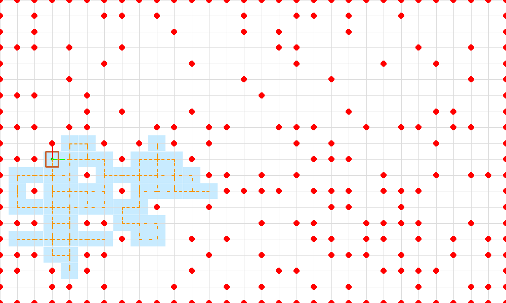
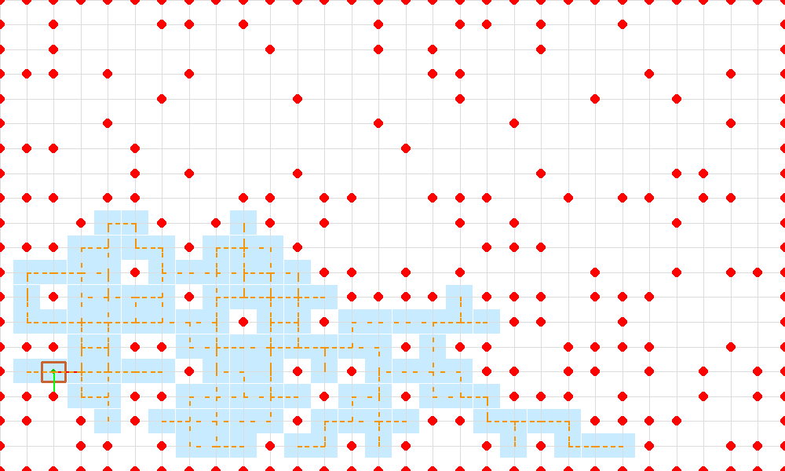
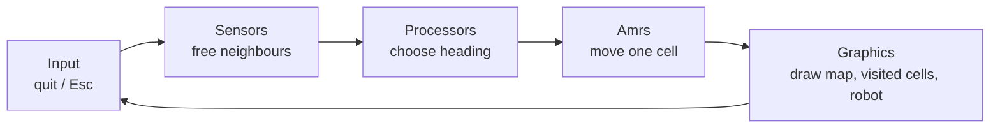

# MazeRunner

A small micromouse-style simulation. A robot (AMR) starts in a randomly generated grid of obstacles, reads its four neighbouring cells with a simple sensor, decides where to go, and moves one cell at a time until it has visited every cell it can reach.

There are two versions:

- **Python + pygame** (`main.py`): the original simulation with a graphical window.
- **C** (`c/`): a port of the same logic that runs in the terminal with ASCII graphics and no dependencies, closer to what would run on a real micromouse board.

| Random walk, 300 steps | Explore, 300 steps |
|---|---|
|  |  |

Red dots are obstacles, blue cells have been visited, and the dashed orange line is the path the robot took. Both runs use the same map (`seed=7`). The random walk has covered half of the reachable area. Explore finished all of it by step 185.

## Strategies

**random** is the original behaviour. At each cell the robot picks a random free direction, but never turns straight back unless it is in a dead end.

**explore** (default) works the way a micromouse maps a maze:

1. If a neighbouring cell hasn't been visited yet, go there.
2. If every neighbour has been visited, run a breadth-first search (the same idea as flood fill) to find the nearest unvisited cell, and follow that path.
3. Once nothing is left to visit, fall back to the random walk.

On 30×30 maps with the C version:

| Seed | Reachable cells | explore (steps) | random (steps) |
|---|---|---|---|
| 1 | 514 | 834 | 5976 |
| 2 | 535 | 895 | 6824 |
| 3 | 529 | 861 | 9832 |
| 5 | 497 | 808 | 8625 |

Explore needs roughly 1.6 steps per cell, against 12 to 19 for the random walk.

## Python version

### Run

```bash
pip install -r requirements.txt
python main.py
```

Options:

| Flag | Default | Meaning |
|---|---|---|
| `--strategy` | `explore` | `explore` or `random` |
| `--seed` | random | same seed gives the same map and run |
| `--rows`, `--cols` | 30, 30 | map size, border included |
| `--width`, `--height` | 1400, 800 | window size in pixels |
| `--fps` | 3 | moves per second |

Close the window or press `Esc` to quit. The title bar shows the step count and how many reachable cells have been visited.

`test.py` shows how to extend `Application` with your own `initialize()` and `update()` hooks.

### How the main loop works



| File | Role |
|---|---|
| `core/application.py` | main loop: input, sense, decide, move, draw |
| `core/map.py` | grid map with a border and random obstacles |
| `core/amr.py` | robot position, heading and path history |
| `core/graphic.py` | pygame drawing of the grid, visited cells and robot |
| `core/input.py` | window close and `Esc` handling |
| `component/sensor.py` | returns the free headings (0, 90, 180, 270) around the robot |
| `component/processor.py` | decision rules and planned path |
| `utils/utils.py` | pixel/node conversion, 2D transforms, BFS helpers |

Coordinates: map row 0 is the bottom of the screen. Headings are in degrees: 0 right, 90 up, 180 left, 270 down.

## C version

### Build and run

```bash
cd c
make
./mazerunner
```

Without `make`:

```bash
gcc -std=c99 -O2 -Wall -o mazerunner main.c maze.c robot.c rng.c
```

Options:

| Flag | Default | Meaning |
|---|---|---|
| `--strategy` | `explore` | `explore` or `random` |
| `--seed` | current time | same seed gives the same run |
| `--rows`, `--cols` | 30, 30 | map size, border included, up to 64×64 |
| `--steps` | 2000 | stop after this many moves |
| `--delay` | 80 | milliseconds between frames |
| `--quiet` | off | skip the animation, print the final map and stats |

Example output (`./mazerunner --seed 5 --rows 14 --cols 28 --steps 150 --quiet`):

```
########################################################
##  ##      ##. . . . . . . ##            . . . ##. . ##
##        ##  .   ####  ##. . ####  ######. . . . . . ##
##            . ##      ##  . . . ##. ##. ##. . ##. . ##
##  ##      . . ##  ##  ##  . . . . . . . ####. . . . ##
##      ####. ##  ##      ##. . ##########  ####. . . ##
##    ##    .   ##      ##. . ##        ####. . . . . ##
##      ####.             . . . . . ####. . . ##. . ####
####    ####. ####    ##    ##. . .   ##. . ####. . ####
##. .   ####. ##    ##      ##. .   ##. . . . . ##. ####
##. . . . . .     ##        ####. . . . ##. . . . ##. ##
####. . . ####    ####    ##      ##. .   ##. . . . v ##
##  ##. . . . ##  ##    ##        ####    ##. . . ##  ##
########################################################
strategy: explore  steps: 150  visited: 120/220 reachable nodes
```

`#` is an obstacle, `.` a visited cell, and `^ v < >` the robot and its heading.

| File | Role |
|---|---|
| `main.c` | argument parsing, main loop, terminal drawing |
| `maze.c/.h` | grid, random obstacles, reachability count, BFS path to the nearest unvisited cell |
| `robot.c/.h` | sensor reading and the two decision strategies |
| `rng.c/.h` | xorshift random generator, so a seed behaves the same on every platform |

The C version uses the same obstacle density (7 in 22) and the same rules as the Python one. The random generators differ, so the same seed gives a different map in each version.

## Ideas for later

- Real micromouse mazes have thin walls between cells rather than blocked cells. Switching the map to wall bits per cell would make the code usable on a 16×16 competition maze.
- Add a goal in the centre and a second, fast run along the shortest path found during exploration.
- Move the decision code in `c/robot.c` onto a microcontroller and feed it real IR sensor readings.
